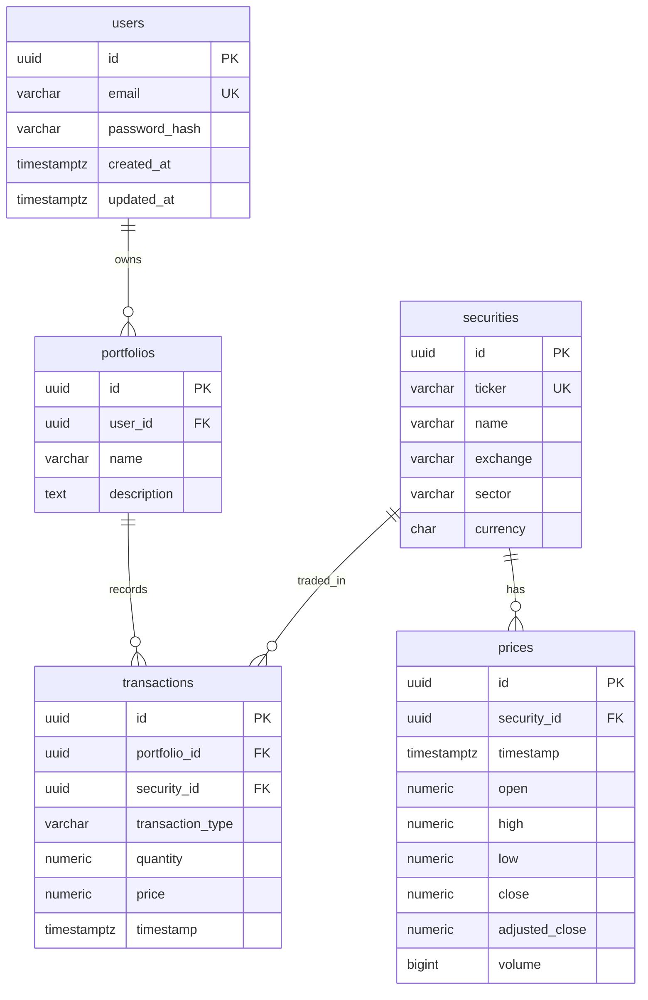

# FinSight

Personal finance analytics API. This repository currently contains **Phases 1–4**: FastAPI, PostgreSQL, SQLAlchemy models, Alembic, synthetic market-data seed, a portfolio/transaction REST API, and time-weighted portfolio analytics. Holdings are derived from the ledger. There is no auth, no Redis, and no frontend.

## Overview

The running stack exposes:

- `GET /health` → `{"status":"ok"}`
- `GET /docs` — FastAPI's interactive OpenAPI UI
- Portfolio CRUD, transactions, derived holdings, and analytics (see [API Documentation](#api-documentation))
- PostgreSQL 16 on the Compose network (published on host port `15432`)

Schema changes go through Alembic, not `Base.metadata.create_all()`. Phase 2 added the five domain tables. Phase 3 adds HTTP access to portfolios and fills. Phase 4 adds time-weighted return, volatility, Sharpe, drawdown, and allocation.

## Why I built this

I wanted a realistic place to practice a production-shaped backend: settings from the environment, structured logs, migrations as versioned code, and a Compose file that actually boots the API and the database together. FinSight's product idea is personal portfolio analytics. Phase 2 locks the relational model so later APIs and analytics sit on constraints and indexes instead of growing out of a single script.

## Architecture

### Current (Phase 4 — built)

```text
                   host :18421
                        │
                        ▼
              ┌─────────────────┐
   Client ──► │  FastAPI        │  /health, /docs
              │  routers        │  /portfolios … /analytics
              └────────┬────────┘
                       │ thin handlers
                       ▼
              ┌─────────────────┐
              │ services        │  holdings = Σ BUY − Σ SELL
              │                 │  TWR, vol, Sharpe, drawdown
              └────────┬────────┘
                       │ repositories
                       ▼
              ┌─────────────────┐
              │ PostgreSQL      │  prices.adjusted_close
              └─────────────────┘
```

Request flow: HTTP → router → `PortfolioService` → repository → SQLAlchemy session → Postgres. The session commits if the handler returns, and rolls back if it raises. `/health` still does not open a database connection.

Auth is **not** implemented. `user_id` is a request field, not a verified identity. Anyone who knows a portfolio UUID can read or change it. Phase 10 will replace this with JWT and ownership checks.

Compose puts `api` and `db` on one user-defined network. The API reaches Postgres at hostname `db`. On the host, the same database is `localhost:15432`. That is why `.env.example` uses `localhost` and `docker-compose.yml` overrides `DATABASE_URL` to `...@db:5432/...`.

### Planned (not built)

| Phase idea | Status |
| --- | --- |
| Auth / login | Table exists; hashing and JWT are not built |
| Portfolio REST API | Built |
| Holdings derived from transactions | Built |
| Portfolio analytics (TWR, vol, Sharpe, DD) | Built |
| Screening | Not built |
| Live market-data API | Not built (seed is synthetic) |
| Redis, background jobs | Not built |
| AI features | Not built |
| Frontend | Not built |

```text
  [future] Browser UI ──► FastAPI routers ──► services ──► SQLAlchemy models
                              │                    │
                              │                    ├── Postgres (source of truth)
                              │                    └── Redis (cache / jobs)   ← not built
                              └── workers / market-data jobs                  ← not built
```

### What each piece solves

**FastAPI request flow.** An HTTP request hits Uvicorn, which calls the ASGI app. Middleware runs first (here: one structured access log). FastAPI then matches the path to a router, resolves `Depends(...)` (`get_db`, then `get_portfolio_service`), and invokes the handler. The handler stays thin: validate input with Pydantic, call a service, return a response model. `/health` has no service layer because it only reports process liveness.

**Docker Compose networking.** Each service is reachable by its Compose service name on an isolated bridge network. `depends_on` with a Postgres healthcheck means the API container starts only after `pg_isready` succeeds. Publishing `18421:8000` is a host-port mapping; inside the container the app still listens on `8000`.

**SQLAlchemy vs Alembic.** SQLAlchemy is the runtime toolkit: engine, connection pool, sessions, and ORM models. Alembic is the migration runner: it stores revision files and applies them in order. They share `Base.metadata`. Application startup never calls `create_all()`.

**Why no `create_all` on startup.** `Base.metadata.create_all()` creates missing tables and then stops. It will not alter a column, drop a constraint, or record what changed. Alembic revisions are reviewable, reversible, and the same in every environment.

## Database Design

### Why PostgreSQL

Portfolios, fills, and prices are relational: a user owns portfolios, a portfolio has transactions, a transaction points at a security, a security has a time series of prices. PostgreSQL gives foreign keys (invalid references cannot be inserted), `NUMERIC` for money, composite unique indexes for idempotent ingest, and `EXPLAIN ANALYZE` for Phase 8. A document store would push those joins and constraints into application code. SQLite is fine for unit tests of constraints; it is not the production dialect.

### Entity relationship

```text
User 1 ──── * Portfolio 1 ──── * Transaction * ──── 1 Security 1 ──── * Price
```



There is **no holdings table**. A position is the running sum of BUY quantity minus SELL quantity. Storing holdings would duplicate the ledger and go stale the first time a write missed the cache row. Phase 3 computes this in `app/services/holdings.py` after loading the portfolio's fills. That is O(fills in one portfolio), which is the right default until a portfolio has enough history that a SQL `SUM`/`GROUP BY` is worth measuring.

`users.password_hash` exists so portfolios have a real owner. Login, hashing, and JWT wait for Phase 10. Do not treat the column as “auth is done.” The seed inserts a demo user with a fixed UUID so you can call the API locally.

### Types

Monetary values and share quantities are `NUMERIC` / `Decimal`, never `FLOAT`. Binary floating point cannot represent `0.1` exactly; summing thousands of prices would drift. Volume is `BIGINT` (a count). Daily bars use `TIMESTAMPTZ` at `00:00 UTC` for that calendar day.

### Foreign keys

| Child | Parent | On delete |
| --- | --- | --- |
| `portfolios.user_id` | `users.id` | `CASCADE` — deleting a user removes their portfolios |
| `transactions.portfolio_id` | `portfolios.id` | `CASCADE` — deleting a portfolio removes its fills |
| `prices.security_id` | `securities.id` | `CASCADE` — prices belong to the listing |
| `transactions.security_id` | `securities.id` | `RESTRICT` — a traded security cannot disappear |

PostgreSQL rejects an insert whose FK does not match. That is the database, not the API, enforcing integrity.

### Indexing

Indexes match expected query patterns. Each extra index slows inserts.

| Index | Query it supports | Column order | Tradeoff |
| --- | --- | --- | --- |
| `uq_users_email` | Look up / register by email | single column | Unique constraint; required anyway |
| `uq_securities_ticker` | `WHERE ticker = 'AAPL'` | single column | Unique constraint; required anyway |
| `ix_portfolios_user_id` | List portfolios for a user | `user_id` | Postgres does **not** auto-index FKs |
| `uq_prices_security_id_timestamp` | History for one security in a date range; idempotent ingest | equality on `security_id`, then range on `timestamp` | Unique btree serves both constraint and access path. Reversed columns would scan every symbol at one timestamp. |
| `ix_transactions_portfolio_id_timestamp` | Ledger for one portfolio, time order | `portfolio_id`, `timestamp` | Write cost per fill |
| `ix_transactions_portfolio_id_security_id` | All fills of one ticker in one portfolio (holdings) | `portfolio_id`, `security_id` | Second index on the same table. No `transactions(security_id)` — “every AAPL trade in the system” is not a Phase 3 path. |

`prices` does not need a separate `security_id` index. The unique composite already leads with `security_id`.

Phase 8 will measure these with `EXPLAIN ANALYZE` on a large synthetic `prices` table. Do not add covering indexes or materialized views until that baseline exists.

## Seed data

`scripts/seed_database.py` upserts:

- AAPL, MSFT, NVDA, AMZN, GOOGL, META, TSLA
- Weekday daily OHLCV from 2024-01-02 through 2025-12-31 (~522 bars per ticker)
- Demo user `demo@finsight.local` with id `00000000-0000-4000-8000-000000000001`

Prices are a seeded random walk, not live quotes. The same command is idempotent: securities update in place, existing `(security_id, timestamp)` rows are skipped (`ON CONFLICT DO NOTHING`). The demo user is inserted with `ON CONFLICT DO NOTHING` on id.

## API Documentation

Interactive docs: http://127.0.0.1:18421/docs after `make up`.

| Method | Path | Purpose |
| --- | --- | --- |
| `POST` | `/portfolios` | Create a portfolio (`user_id`, `name`, `description?`) |
| `GET` | `/portfolios?user_id=` | List that user's portfolios |
| `GET` | `/portfolios/{id}` | Portfolio plus current holdings |
| `PATCH` | `/portfolios/{id}` | Update name and/or description |
| `DELETE` | `/portfolios/{id}` | Delete portfolio and its fills (`204`) |
| `POST` | `/portfolios/{id}/transactions` | Record a BUY or SELL |
| `GET` | `/portfolios/{id}/transactions` | Ledger, oldest first |
| `GET` | `/portfolios/{id}/holdings` | Derived positions |
| `GET` | `/portfolios/{id}/analytics` | TWR, volatility, Sharpe, drawdown, allocation |

Example: BUY 10 AAPL, BUY 5 AAPL, SELL 3 AAPL → holdings show `12` AAPL.

`POST /portfolios/{id}/transactions` body:

```json
{
  "ticker": "AAPL",
  "transaction_type": "BUY",
  "quantity": "10",
  "price": "185.50",
  "timestamp": "2024-06-03T14:30:00Z"
}
```

Tickers are normalized to uppercase. Quantity and price are JSON strings so the client does not round `Decimal` values through IEEE floats. Timestamp defaults to now (UTC).

A SELL that would take the position below zero returns **409**. Unknown user, portfolio, or ticker returns **404**. Money fields that are not `> 0` return **422**. Analytics without transactions or without prices returns **409**.

### Why this API shape

Portfolios are a collection; fills belong to one portfolio, so they are nested (`/portfolios/{id}/transactions`). Holdings are a **read model**, not a resource you POST to, so they are `GET` only. Analytics is another read model over the same ledger plus `prices`. We do not expose `security_id` on the write path: the public key for a listing is `ticker`.

### Analytics assumptions

`GET /portfolios/{id}/analytics` is **not investment advice**. The response includes an `assumptions` object so the method is visible, not hidden in code.

| Choice | What we do | Why |
| --- | --- | --- |
| Return | Time-weighted, daily | Strips deposits/withdrawals so a BUY is not a gain |
| Daily TWR | `(V_t − V_{t-1} − CF_t) / V_{t-1}` | `CF_t` is +BUY notional / −SELL notional |
| Total return | `Π(1 + r_t) − 1` | Geometric over the sample; **not** annualized |
| Annualized return | `(1 + TWR)^(252/n) − 1` | Comparable to the 252-day year used for vol |
| Volatility | sample stdev of daily TWR × √252 | Sample uses n−1; needs ≥ 2 daily returns |
| Risk-free rate | `RISK_FREE_RATE` annual, default 5% | Teaching placeholder, not a T-bill quote |
| Sharpe | `(mean(r) − rf/252) / σ_daily` | Arithmetic daily rf. `null` when σ is 0 |
| Max drawdown | min(wealth / peak − 1) on the TWR index | Always ≤ 0 |
| Mark | `adjusted_close` on or before the day | Fill price is fallback if no close yet |
| Cash | No cash sleeve | SELL proceeds leave the portfolio |
| Allocation | qty × last mark / total MV | Current snapshot, not a time series |

There is still no holdings table. Analytics rebuilds positions from transactions each request, then marks them with the `prices` rows. That is the correct default until Phase 8 measures it on a large dataset.

Alternative we did **not** pick: money-weighted IRR. IRR answers “what compound rate did *this cash-flow schedule* earn?” TWR answers “how did the strategy perform regardless of when money was added?” FinSight’s product question is the second one.

### Concurrent updates

Two SELL requests for the same last share can both pass a naive read-check-write. On PostgreSQL, recording a fill does `SELECT ... FOR UPDATE` on the portfolio row first, so the second request waits, sees the updated quantity, and gets 409 if nothing is left. SQLite (used in unit/API tests) ignores `FOR UPDATE`; the tests still cover the check in a single session. This is **not** a user-level permission check. Two different users hitting the same UUID is still allowed until Phase 10.

Local example after `make migrate && make seed`:

```bash
curl -X POST http://127.0.0.1:18421/portfolios \
  -H 'Content-Type: application/json' \
  -d '{"user_id":"00000000-0000-4000-8000-000000000001","name":"Core"}'
```

## Tech Stack

| Piece | Why |
| --- | --- |
| Python 3.12+ | Language runtime |
| FastAPI + Pydantic | HTTP API and request/response schemas |
| Uvicorn | ASGI server |
| SQLAlchemy 2.x | Engine, session, ORM models |
| Alembic | Schema migrations |
| PostgreSQL 16 | Primary database |
| psycopg 3 | Postgres driver (`postgresql+psycopg://`) |
| pytest + httpx | API and constraint tests |
| Ruff | Lint |
| Docker Compose | Local `api` + `db` |

No Redis. No Celery. No extra services.

## Running Locally

### Docker Compose (preferred)

```bash
docker compose up --build
# or: make up
make migrate
make seed
```

Then:

- Health: http://127.0.0.1:18421/health
- OpenAPI: http://127.0.0.1:18421/docs

Stop with `make down`.

### Tests and lint (host)

```bash
python3.12 -m venv .venv
source .venv/bin/activate
pip install -e ".[dev]"
make test
make lint
```

Constraint tests use in-memory SQLite (foreign keys on). API tests override `get_db` with that same SQLite session. The integration test that runs `alembic upgrade head` against Postgres is skipped when the database is unreachable. `/health` still does not open a database connection.

Host migrate/seed against the published port:

```bash
make migrate-host
make seed-host
```

### Environment variables

Copy `.env.example` to `.env` only if you run Uvicorn on the host against the published Postgres port. Compose injects `DATABASE_URL` for the `api` service and does not require a `.env` file. `.env` is gitignored.

| Variable | Purpose |
| --- | --- |
| `APP_NAME` | OpenAPI title |
| `ENVIRONMENT` | Logged on startup |
| `LOG_LEVEL` | Root log level |
| `DATABASE_URL` | SQLAlchemy / Alembic URL |
| `RISK_FREE_RATE` | Annual decimal for Sharpe (default `0.05`) |
| `TRADING_DAYS_PER_YEAR` | Annualization factor (default `252`) |

Local Compose credentials (`finsight` / `finsight`) are development defaults, not production secrets.

## Makefile

| Target | Action |
| --- | --- |
| `make up` | `docker compose up --build -d` |
| `make down` | `docker compose down` |
| `make logs` | Follow API logs |
| `make test` | pytest |
| `make lint` | Ruff |
| `make migrate` | `alembic upgrade head` inside the API container |
| `make seed` | Seed securities and prices inside the API container |
| `make migrate-host` | Alembic against `DATABASE_URL` on the host |
| `make seed-host` | Seed against `DATABASE_URL` on the host |
