# FinSight

Personal finance analytics API. Phases 1–12 are the learning backend: FastAPI, PostgreSQL, Alembic, portfolio analytics, daily-bar ingest, screening, a 10-million-row benchmark, Redis caching, JWT, and an assistant that answers from stored portfolio evidence. Live quotes, a separate market worker, structured model output, and a Next.js dashboard sit on that same boundary. Holdings are derived from the ledger. `/ui` is the small static demo. `web/` is the live dashboard.

## Overview

The running stack exposes:

- `GET /health` → `{"status":"ok"}`
- `GET /docs` — FastAPI's interactive OpenAPI UI
- Portfolio CRUD, transactions, derived holdings, and analytics (see [API Documentation](#api-documentation))
- Market-data ingest into `prices` (see [Data Pipeline](#data-pipeline))
- Scheduled `update_market_data` job plus `GET /jobs` (see [Background Jobs](#background-jobs))
- Structured `POST /screen` over seeded fundamentals (see [Screening](#screening))
- Measured `EXPLAIN ANALYZE` workflow (see [Performance Engineering](#performance-engineering))
- Redis caching and `GET /cache/stats` (see [Caching Strategy](#caching-strategy))
- Demo UI at `/ui` (login, portfolios, analytics, screening, ask, jobs, cache)
- PostgreSQL 16 on the Compose network (published on host port `15432`)

Schema changes go through Alembic, not `Base.metadata.create_all()`. Phase 2 added the five domain tables. Phase 3 adds HTTP access to portfolios and fills. Phase 4 adds portfolio analytics. Phase 5 ingests vendor daily bars. Phase 6 schedules ingest. Phase 7 adds safe screening. Phase 8 measures and optimizes price-history reads. Phase 9 caches analytics and screens while PostgreSQL remains authoritative. Phase 10 adds password authentication, signed access tokens, and portfolio ownership checks. Phase 11 adds the test layers for those behaviors. Phase 12 adds an assistant that answers from stored evidence and turns a narrow English screen into the same structured filter.

## Why I built this

I wanted a realistic place to practice a production-shaped backend: settings from the environment, structured logs, migrations as versioned code, and a Compose file that actually boots the API and the database together. FinSight's product idea is personal portfolio analytics. Phase 2 locks the relational model so later APIs and analytics sit on constraints and indexes instead of growing out of a single script.

## Architecture

### Current (Phase 13 — built)

```text
 Next.js :3000 ──┐
 Browser /ui  ──┼──► FastAPI :18421
 API client   ──┘    routers stay thin
                          │
        ┌─────────────────┼──────────────────┐
        ▼                 ▼                  ▼
 PortfolioService   AnalyticsService    AssistantService
 ScreeningService   holdings + TWR      model has no session
 WatchlistService   positions           allowlisted tools
        │                 │                  │
        └──────── commit, then invalidate ──┘
                          │
              ┌───────────┴───────────┐
              ▼                       ▼
        PostgreSQL               Redis :16379
        source of truth          cache, live quotes,
              ▲                  news, worker heartbeat
              │ upsert prices, write job_runs
        APScheduler thread
        update_market_data

 quote worker (separate process)
        │ watchlist tickers, or QUOTE_SYMBOLS when none exist
        ▼
 Redis finsight:live:{ticker} + pub/sub finsight:live
```

Request flow: HTTP → router → `PortfolioService` → repository → SQLAlchemy session → Postgres. A successful response is committed before the body is sent, so the next request can read the row it just created. A raised error rolls the session back. `/health` still does not open a database connection.

Portfolio routes require a Bearer access token. The token subject identifies the owner; clients cannot choose `user_id`. Portfolio lookups include that owner in the database query, and cross-user IDs return **404** without revealing whether the resource exists.

### Request flows

**Register and login.** `POST /auth/register` hashes the password with Argon2 and stores the user. A duplicate email is a conflict, including when two inserts race the unique constraint. `POST /auth/login` looks up the email and checks the hash. An unknown email and a wrong password share one error. A valid login returns an HS256 access token whose subject is the user id. Later requests send `Authorization: Bearer`. `get_current_user` decodes the token, loads that user, and `PortfolioService` is constructed with `current_user.id`. Every portfolio query filters on that id.

**Transaction, holdings, analytics, cache.** `POST /portfolios/{id}/transactions` locks the owned portfolio row (`SELECT … FOR UPDATE` on PostgreSQL). A sell larger than the derived holding is rejected. The fill is inserted, and the service queues a version bump for `portfolio:{id}`. After the request commits, that bump drops cached analytics for the portfolio. Holdings are not a stored table: quantity is buys minus sells. `GET …/analytics` checks ownership, then Redis. A miss recalculates time-weighted return, volatility, Sharpe, and max drawdown from the ledger and stored closes, then writes the JSON with a TTL.

**Market ingestion.** APScheduler calls `update_market_data` on its own thread. The job writes a `job_runs` row, skips a second overlapping run, fetches bars through the provider, and upserts prices. If any row was upserted, it queues a `prices` version bump. The next screen or analytics read misses cache and loads PostgreSQL. `GET /jobs` lists those rows. The demo process used for the screenshots was started with `SCHEDULER_ENABLED=false`, so that table can be empty until a job runs.

**Natural-language screening.** `POST /screen/natural` gives the sentence to the assistant model. The default rules parser returns a `ScreenRequest`. Extra keys, including `sql`, are rejected. Pagination `limit` and `offset`, plus `sort_by` and `sort_direction`, come from the HTTP body, then `ScreeningService` runs the same parameterized fundamental query as `POST /screen`. `POST /portfolios/{id}/ask` loads analytics first (ownership and calculation), splits facts from metrics, and only then asks the model to restate that evidence. The model object has no database session.

Compose puts `api`, `quotes`, `web`, `db`, and `redis` on one user-defined network. The API reaches the data stores at hostnames `db` and `redis`. On the host, PostgreSQL is `localhost:15432` and Redis is `localhost:16379`. Compose overrides both URLs with container hostnames.

### Live quotes

Daily bars stay in PostgreSQL and still feed analytics. A current price is a different object: the quote worker writes `finsight:live:{ticker}` in Redis and publishes the same JSON on `finsight:live`. `GET /quotes` and `/ws/quotes` read that cache. They do not open a vendor socket, and they do not insert ticks.

```text
Finnhub WebSocket or Alpha Vantage GLOBAL_QUOTE or simulator
        │
        ▼
 quote worker          (separate process)
        │
        ▼
 Redis latest quote + pub/sub
        │
        ▼
 FastAPI /ws/quotes
        │
        ▼
 Next.js watchlist
```

`QUOTE_PROVIDER=simulator` is the default and needs no API key. Its quotes are labeled `simulated`, not realtime. The worker follows active watchlist tickers, up to `QUOTE_MAX_SYMBOLS`. With no watchlist items it falls back to `QUOTE_SYMBOLS`. `QUOTE_PROVIDER=finnhub` subscribes to the trade stream and reconnects after a dropped socket. Those trades start as `realtime`; once `QUOTE_STALE_AFTER_SECONDS` passes they become `stale`. `QUOTE_PROVIDER=alpha_vantage` polls `GLOBAL_QUOTE`, labeled `delayed` unless `ALPHA_VANTAGE_REALTIME=true`. It can refresh fundamentals onto an existing row. Headlines stay in Redis (`finsight:news:{ticker}`) and are not invented by the simulator. Set `NEWS_PROVIDER=none` to skip news, or `finnhub` / `alpha_vantage` when a key should fill the cache.

Each live quote exposes the provider timestamp, the time FinSight received it, age, source, and `timeliness`. Positions copy that freshness. `GET /ready` checks PostgreSQL and Redis. `GET /status` reports the quote provider, the latest ingest job, cache counters, the worker heartbeat, and operational counters. The worker heartbeat is Redis state, not a database row.

The assistant still receives facts and metrics only. `AI_PROVIDER=openai` uses the Responses API by default (`AI_OPENAI_API=responses`) and can fall back to Chat Completions (`AI_OPENAI_API=chat`). Structured screens and interpretations use strict JSON schemas. `POST /portfolios/{id}/ask/stream` sends server-sent events after ownership and evidence are loaded. The browser never sees the API key. `POST /assistant/tools/execute` runs one authenticated allowlisted operation: portfolio analytics, screening, a current quote, fundamentals, or recent news. Fields named `sql`, `query`, `raw_sql`, or `database_query` are rejected.

The Next.js app is `web/`. It has a dashboard, user watchlists, screening, portfolio charts, a security page at `/securities/{ticker}`, and a streaming assistant. `/stocks/{ticker}` redirects to that security page. `/ui` remains the earlier static demo.

### Phase status

| Phase idea | Status |
| --- | --- |
| Auth / login | Built (Argon2 password hashes and JWT access tokens) |
| Portfolio REST API | Built |
| Holdings derived from transactions | Built |
| Portfolio analytics (TWR, vol, Sharpe, DD) | Built |
| Market-data ingest (provider + upsert) | Built |
| Background jobs (APScheduler) | Built |
| Screening (structured POST /screen) | Built |
| Query benchmark + covering price index | Built |
| Redis read-through cache | Built |
| Test suite (unit, API, PostgreSQL integration) | Built |
| AI assistant and natural-language screen | Built (local rules by default; optional Responses or chat API) |
| Security universe, watchlists, controlled historical ingest | Built |
| Live quotes, news cache, freshness, readiness | Built |
| Next.js dashboard | Built in `web/` |
| Static demo | Still mounted at `/ui` |

The demo page is static HTML, CSS, and JavaScript mounted by FastAPI. It stores the access token in `sessionStorage` and renders JSON from the existing routes. Portfolio math, screening, and the assistant stay in the services.

### What each piece solves

**FastAPI request flow.** An HTTP request hits Uvicorn, which calls the ASGI app. Middleware runs first (here: one structured access log). FastAPI then matches the path to a router, resolves `Depends(...)` (`get_db`, then `get_portfolio_service`), and invokes the handler. The handler stays thin: validate input with Pydantic, call a service, return a response model. `/health` has no service layer because it only reports process liveness.

**Docker Compose networking.** Each service is reachable by its Compose service name on an isolated bridge network. `depends_on` with a Postgres healthcheck means the API container starts only after `pg_isready` succeeds. Publishing `18421:8000` is a host-port mapping; inside the container the app still listens on `8000`.

**SQLAlchemy vs Alembic.** SQLAlchemy is the runtime toolkit: engine, connection pool, sessions, and ORM models. Alembic is the migration runner: it stores revision files and applies them in order. They share `Base.metadata`. Application startup never calls `create_all()`.

**Why no `create_all` on startup.** `Base.metadata.create_all()` creates missing tables and then stops. It will not alter a column, drop a constraint, or record what changed. Alembic revisions are reviewable, reversible, and the same in every environment.

## Database Design

### Why PostgreSQL

Portfolios, fills, and prices are relational: a user owns portfolios, a portfolio has transactions, a transaction points at a security, a security has a time series of prices. PostgreSQL gives foreign keys (invalid references cannot be inserted), `NUMERIC` for money, composite unique indexes for idempotent ingest, and `EXPLAIN ANALYZE` for Phase 8. A document store would push those joins and constraints into application code. SQLite is fine for unit tests of constraints; it is not the production dialect.

### Entity relationship

```text
User 1 ──── * Portfolio 1 ──── * Transaction * ──── 1 Security 1 ──── * Price
                                                                 └── 0..1 Fundamental
```

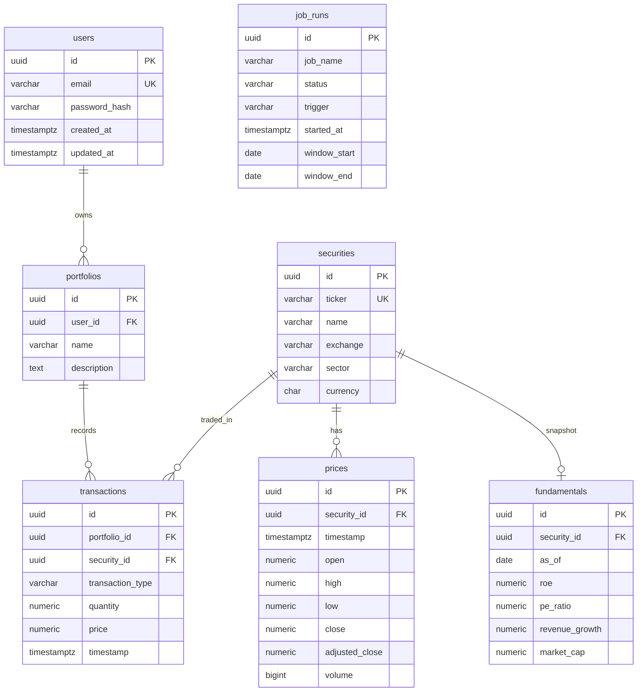

There is **no holdings table**. A position is the running sum of BUY quantity minus SELL quantity. Storing holdings would duplicate the ledger and go stale the first time a write missed the cache row. Phase 3 computes this in `app/services/holdings.py` after loading the portfolio's fills. That is O(fills in one portfolio), which is the right default until a portfolio has enough history that a SQL `SUM`/`GROUP BY` is worth measuring.

`job_runs` is operational state, not a domain entity. It has no foreign keys. A job run records that ingest happened; it does not belong to a user or a portfolio.

`fundamentals` is a **latest snapshot**, not a quarterly time series. Screening “ROE > 15% today” does not need history. Unique `security_id` means a re-seed overwrites the row. Phase 8 can add `(security_id, as_of)` if we measure a need for it.

`users.password_hash` stores an Argon2 hash for authentication. The seed inserts a
demo user with a fixed UUID and placeholder hash for relational sample data; that
user cannot log in. Register through `/auth/register` to create login credentials.

### Types

Monetary values and share quantities are `NUMERIC` / `Decimal`, never `FLOAT`. Binary floating point cannot represent `0.1` exactly; summing thousands of prices would drift. Volume is `BIGINT` (a count). Daily bars use `TIMESTAMPTZ` at `00:00 UTC` for that calendar day.

### Foreign keys

| Child | Parent | On delete |
| --- | --- | --- |
| `portfolios.user_id` | `users.id` | `CASCADE` — deleting a user removes their portfolios |
| `transactions.portfolio_id` | `portfolios.id` | `CASCADE` — deleting a portfolio removes its fills |
| `prices.security_id` | `securities.id` | `CASCADE` — prices belong to the listing |
| `fundamentals.security_id` | `securities.id` | `CASCADE` — the snapshot belongs to the listing |
| `transactions.security_id` | `securities.id` | `RESTRICT` — a traded security cannot disappear |

PostgreSQL rejects an insert whose FK does not match. That is the database, not the API, enforcing integrity.

### Indexing

Indexes match expected query patterns. Each extra index slows inserts.

| Index | Query it supports | Column order | Tradeoff |
| --- | --- | --- | --- |
| `uq_users_email` | Look up / register by email | single column | Unique constraint; required anyway |
| `uq_securities_ticker` | `WHERE ticker = 'AAPL'` | single column | Unique constraint; required anyway |
| `ix_portfolios_user_id` | List portfolios for a user | `user_id` | Postgres does **not** auto-index FKs |
| `uq_prices_security_id_timestamp` | History for one security in a date range; idempotent ingest | equality on `security_id`, then range on `timestamp`; `INCLUDE (adjusted_close)` | Unique covering btree serves the constraint and lets the projected analytics read use an index-only scan after vacuum. Extra leaf data increases index size and write I/O. |
| `ix_transactions_portfolio_id_timestamp` | Ledger for one portfolio, time order | `portfolio_id`, `timestamp` | Write cost per fill |
| `ix_transactions_portfolio_id_security_id` | All fills of one ticker in one portfolio (holdings) | `portfolio_id`, `security_id` | Second index on the same table. No `transactions(security_id)` — “every AAPL trade in the system” is not a Phase 3 path. |
| `ix_job_runs_job_name_started_at` | Latest runs of one job | `job_name`, `started_at` | Write cost per job start |
| `uq_job_runs_running_job_name` | At most one `running` row per job | unique on `job_name` WHERE `status = 'running'` | Database mutex. A crashed process leaves `running` until the stale timeout. |
| `uq_fundamentals_security_id` | Join / overwrite the latest snapshot | `security_id` | No `roe` / `pe_ratio` indexes yet. Seven rows do not need them; Phase 8 will measure. |

`prices` does not need a separate `security_id` index. The unique composite already leads with `security_id`.

Phase 8 measures this with `EXPLAIN (ANALYZE, BUFFERS, FORMAT JSON)` on a deterministic 10-million-row synthetic `prices` dataset. Screening metric indexes and materialized views are still deferred: seven fundamental rows do not justify them.

## Seed data

`scripts/seed_database.py` upserts:

- AAPL, MSFT, NVDA, AMZN, GOOGL, META, TSLA
- Weekday daily OHLCV from 2024-01-02 through 2025-12-31 (~522 bars per ticker)
- Latest fundamental snapshots (`as_of` 2025-12-31): ROE, P/E, revenue growth, market cap. Synthetic, not live filings.
- Demo user `demo@finsight.local` with id `00000000-0000-4000-8000-000000000001`

Prices are a seeded random walk, not live quotes. Use that for tests and first-time local data. To replace seed bars with vendor prints, run the ingest CLI (see [Data Pipeline](#data-pipeline)). Seed is still idempotent: securities update in place, existing `(security_id, timestamp)` rows are skipped (`ON CONFLICT DO NOTHING`). The demo user is inserted with `ON CONFLICT DO NOTHING` on id.

## Data Pipeline

Ingest is **not** an HTTP request. A user click must not wait on a vendor download. Phase 6 runs the same callable on a cron; the CLI still exists for backfills.

```text
APScheduler / CLI
     │
     ▼
update_market_data (job_runs row)
     │
     ▼
External API
     │
     ▼
MarketDataProvider.fetch_daily_bars
     │
     ▼
normalize_bar (drop invalid OHLCV)
     │
     ▼
INSERT … ON CONFLICT (security_id, timestamp) DO UPDATE
     │
     ▼
PostgreSQL prices
```

**Why a provider interface.** The rest of FinSight (analytics, holdings) reads `prices`. If Alpha Vantage changes or the free tier disappears, only `app/market_data/alpha_vantage.py` changes. `MarketDataService` never imports a vendor client.

| Provider | Env | Key | Notes |
| --- | --- | --- | --- |
| `stooq` (default) | `MARKET_DATA_PROVIDER=stooq` | none | CSV daily bars, US tickers as `{ticker}.us` |
| `alpha_vantage` | `MARKET_DATA_PROVIDER=alpha_vantage` | `MARKET_DATA_API_KEY` | `TIME_SERIES_DAILY`. Free bars have no split-adjusted close; we store `adjusted_close = close`. Free tier is rate-limited. |

The API key is read from the environment only. It is not logged, not accepted as a CLI flag, and not in git. `.env` is gitignored.

**Idempotency.** Unique `(security_id, timestamp)` is the business key. A second ingest cannot insert a duplicate day. `ON CONFLICT DO UPDATE` overwrites OHLCV so a vendor revision (or a switch from seed random-walk to a real print) replaces the row. Unknown tickers are skipped (they must exist in `securities` from seed). One ticker failing (HTTP, rate limit) does not abort the others; the process exits non-zero if any ticker failed.

```bash
make seed          # synthetic bars, demo user
make ingest        # vendor bars for the seeded universe
# or:
python scripts/ingest_market_data.py --ticker AAPL --start 2024-01-02 --provider stooq
```

Tests never call a live vendor. Parsers are unit-tested with fixture JSON/CSV; ingest is tested with a `FakeProvider`.

## Background Jobs

HTTP request threads must not download market data. The product need is “keep `prices` fresh.” The engineering need is “do that without blocking `/analytics`.”

```text
FastAPI process
 ├── Uvicorn (handles HTTP)
 └── BackgroundScheduler (one thread pool)
         cron 0 22 * * * UTC
              │
              ▼
         update_market_data
              │
              ├── INSERT job_runs status=running
              ├── MarketDataService.ingest
              └── UPDATE job_runs success|failed
```

**Why APScheduler, not Celery/RQ.** Celery needs a broker (Redis or RabbitMQ). Redis is Phase 9. The spec said start simple and design so a real queue can be added later. APScheduler runs **in the API process**, on a thread, with a cron trigger. The job function is the same `update_market_data` the CLI calls. Swapping to a worker process later means pointing that worker at the same function; the HTTP app does not change.

**Tradeoff.** The scheduler dies with the API process. Two Uvicorn workers would start two schedulers and double-fire the cron. FinSight’s Dockerfile runs **one** Uvicorn worker. The unique partial index `uq_job_runs_running_job_name` is the safety net if that ever changes: a second process that tries to insert another `running` row loses the race and records `skipped`.

**Why 22:00 UTC.** US cash equities close at 16:00 Eastern. That is 20:00 UTC in EDT and 21:00 UTC in EST. 22:00 UTC is after both, so the vendor has time to publish the daily bar. Override with `MARKET_DATA_CRON`.

**Lookback.** Each scheduled run fetches `[today − MARKET_DATA_LOOKBACK_DAYS, today]` (default 7). Weekends and a missed day are covered. Upsert makes overlapping days cheap. The CLI still defaults to `2024-01-02` → today so a manual run can backfill.

**Job status.** Logs are not a queryable history. `job_runs` stores `running` / `success` / `failed` / `skipped`, the date window, counts, and failed tickers. `GET /jobs` is read-only. There is no `POST /jobs` — that would invite an HTTP client to wait on a download. Trigger ingest with the CLI or wait for the cron. A `running` row older than `JOB_STALE_AFTER_SECONDS` (default 1 hour) is marked `failed` (`stale_running`) so a crash cannot block the next cron.

**Tests.** `SCHEDULER_ENABLED=false` is set in `tests/conftest.py` before the app is imported, so `TestClient` does not start APScheduler or call Stooq.

```bash
curl http://127.0.0.1:18421/jobs?job_name=update_market_data
python scripts/ingest_market_data.py --ticker AAPL --start 2024-01-02
```

## API Documentation

Interactive docs: http://127.0.0.1:18421/docs after `make up`.

| Method | Path | Purpose |
| --- | --- | --- |
| `POST` | `/auth/register` | Create an account |
| `POST` | `/auth/login` | Exchange email and password for an access token |
| `GET` | `/auth/me` | Return the authenticated user |
| `POST` | `/portfolios` | Create a portfolio (`name`, `description?`) |
| `GET` | `/portfolios` | List the authenticated user's portfolios |
| `GET` | `/portfolios/{id}` | Portfolio plus current holdings |
| `PATCH` | `/portfolios/{id}` | Update name and/or description |
| `DELETE` | `/portfolios/{id}` | Delete portfolio and its fills (`204`) |
| `POST` | `/portfolios/{id}/transactions` | Record a BUY or SELL |
| `GET` | `/portfolios/{id}/transactions` | Ledger, oldest first |
| `GET` | `/portfolios/{id}/holdings` | Derived positions |
| `GET` | `/portfolios/{id}/analytics` | TWR, volatility, Sharpe, drawdown, allocation |
| `POST` | `/portfolios/{id}/ask` | Explain a portfolio from stored evidence |
| `POST` | `/portfolios/{id}/ask/stream` | Same answer as server-sent events |
| `GET` | `/portfolios/{id}/positions` | Live-marked positions, cost basis, and day movers |
| `POST` | `/assistant/tools/execute` | Run one allowlisted read |
| `GET` | `/watchlists` | List the caller's watchlists |
| `POST` | `/watchlists` | Create a watchlist |
| `GET` | `/watchlists/{id}` | One watchlist and a page of items |
| `PATCH` | `/watchlists/{id}` | Rename a watchlist |
| `DELETE` | `/watchlists/{id}` | Delete a watchlist |
| `POST` | `/watchlists/{id}/items` | Add a security |
| `DELETE` | `/watchlists/{id}/items/{security_id}` | Remove a security |
| `GET` | `/securities` | Paginated security universe |
| `GET` | `/securities/search` | Search ticker or name |
| `GET` | `/securities/id/{id}` | One universe row |
| `GET` | `/securities/id/{id}/news` | Cached headlines for that id |
| `GET` | `/securities/{ticker}` | Profile, fundamentals, and stored bars |
| `GET` | `/securities/{ticker}/freshness` | Latest stored bar and its source |
| `GET` | `/news?ticker=` | Cached headlines by ticker |
| `GET` | `/quotes` | Current Redis quotes |
| `WS` | `/ws/quotes?token=` | Relay Redis pub/sub |
| `GET` | `/ready` | PostgreSQL and Redis readiness |
| `GET` | `/status` | Provider, job, cache, worker, and counters |
| `POST` | `/screen/natural` | English screen, executed as a structured filter |
| `GET` | `/jobs?job_name=` | Recent job runs (read-only) |
| `GET` | `/jobs/{id}` | One job run |
| `POST` | `/screen` | Structured security screen (paginated) |
| `GET` | `/cache/stats` | Redis hit/miss/invalidation counters |

Portfolio, transaction, holding, and analytics routes require
`Authorization: Bearer <access-token>`.

### Authentication and ownership

Passwords are hashed with Argon2 and are never returned by the API. Login issues an
HS256 JWT with the user UUID in `sub`, an issuer, issued-at time, token type, and a
30-minute expiry by default. A JWT is signed to prevent tampering; it is **not
encrypted**, so secrets must never be stored in its claims.

`JWT_SECRET_KEY` must be a long random production secret. Token validation uses the
configured algorithm explicitly rather than trusting the token header. Portfolio
ownership comes only from the validated token and is applied in repository queries.
A user requesting another user's portfolio or nested resource receives **404**, not
**403**, so the API does not disclose that the UUID exists.

Phase 10 has access tokens only. There are no refresh tokens or revocation list, so a
valid token cannot be revoked before it expires. Job, screening, cache-stat, health,
readiness, status, and documentation endpoints remain public. Portfolio, watchlist,
security, quote, and news routes require a Bearer token. Another user's portfolio or
watchlist returns **404**.

Example: BUY 10 AAPL, BUY 5 AAPL, SELL 3 AAPL → holdings show `12` AAPL.

`POST /portfolios/{id}/transactions` body:

```json
{
  "ticker": "AAPL",
  "transaction_type": "BUY",
  "quantity": "10",
  "price": "185.50",
  "timestamp": "2024-06-03T14:30:00Z"
}
```

Tickers are normalized to uppercase. Quantity and price are JSON strings so the client does not round `Decimal` values through IEEE floats. Timestamp defaults to now (UTC).

A SELL that would take the position below zero returns **409**. Unknown user, portfolio, or ticker returns **404**. Money fields that are not `> 0` return **422**. Analytics without transactions or without prices returns **409**.

### Why this API shape

Portfolios are a collection; fills belong to one portfolio, so they are nested (`/portfolios/{id}/transactions`). Holdings are a **read model**, not a resource you POST to, so they are `GET` only. Analytics is another read model over the same ledger plus `prices`. Job runs are an **ops read model**: you can inspect status, you cannot start ingest over HTTP. Screening is a **filter object**, not a query string: `POST /screen` so the body can grow (sector, more metrics) without stuffing a URL. We do not expose `security_id` on the write path: the public key for a listing is `ticker`.

### Analytics assumptions

`GET /portfolios/{id}/analytics` is **not investment advice**. The response includes an `assumptions` object so the method is visible, not hidden in code.

| Choice | What we do | Why |
| --- | --- | --- |
| Return | Time-weighted, daily | Strips deposits/withdrawals so a BUY is not a gain |
| Daily TWR | `(V_t − V_{t-1} − CF_t) / V_{t-1}` | `CF_t` is +BUY notional / −SELL notional |
| Total return | `Π(1 + r_t) − 1` | Geometric over the sample; **not** annualized |
| Annualized return | `(1 + TWR)^(252/n) − 1` | Comparable to the 252-day year used for vol |
| Volatility | sample stdev of daily TWR × √252 | Sample uses n−1; needs ≥ 2 daily returns |
| Risk-free rate | `RISK_FREE_RATE` annual, default 5% | Teaching placeholder, not a T-bill quote |
| Sharpe | `(mean(r) − rf/252) / σ_daily` | Arithmetic daily rf. `null` when σ is 0 |
| Max drawdown | min(wealth / peak − 1) on the TWR index | Always ≤ 0 |
| Mark | `adjusted_close` on or before the day | Fill price is fallback if no close yet |
| Cash | No cash sleeve | SELL proceeds leave the portfolio |
| Allocation | qty × last mark / total MV | Current snapshot, not a time series |

There is still no holdings table. Analytics rebuilds positions from transactions each request, then marks them with the `prices` rows. That is the correct default until Phase 8 measures it on a large dataset.

Alternative we did **not** pick: money-weighted IRR. IRR answers “what compound rate did *this cash-flow schedule* earn?” TWR answers “how did the strategy perform regardless of when money was added?” FinSight’s product question is the second one.

### Concurrent updates

Two SELL requests for the same last share can both pass a naive read-check-write.
On PostgreSQL, recording a fill does `SELECT ... FOR UPDATE` on the owned portfolio
row first, so the second request waits, sees the updated quantity, and gets 409 if
nothing is left. SQLite (used in unit/API tests) ignores `FOR UPDATE`; the tests
still cover the check in a single session. The same lookup also filters by the
authenticated owner.

Local example after `make migrate && make seed`:

```bash
curl -X POST http://127.0.0.1:18421/auth/register \
  -H 'Content-Type: application/json' \
  -d '{"email":"me@example.com","password":"choose-a-strong-password"}'

TOKEN=$(curl -s -X POST http://127.0.0.1:18421/auth/login \
  -H 'Content-Type: application/json' \
  -d '{"email":"me@example.com","password":"choose-a-strong-password"}' \
  | python -c 'import json,sys; print(json.load(sys.stdin)["access_token"])')

curl -X POST http://127.0.0.1:18421/portfolios \
  -H "Authorization: Bearer $TOKEN" \
  -H 'Content-Type: application/json' \
  -d '{"name":"Core"}'

curl -X POST http://127.0.0.1:18421/screen \
  -H 'Content-Type: application/json' \
  -d '{"roe_min":"0.15","pe_max":"30","revenue_growth_min":"0.10"}'
```

## Screening

Users should be able to find names that pass simple fundamental rules. They must **not** be able to send SQL.

```text
POST /screen  { roe_min, pe_max, … }
        │
        ▼
Pydantic  extra=forbid, min<=max, Decimal fields
        │
        ▼
ScreeningService → FundamentalRepository
        │
        ▼
SELECT s.*, f.*
FROM securities s
JOIN fundamentals f ON f.security_id = s.id
WHERE f.roe >= :roe_min
  AND f.pe_ratio <= :pe_max
  AND f.revenue_growth >= :revenue_growth_min
ORDER BY s.ticker
LIMIT :limit OFFSET :offset
```

Every comparison is a bound parameter. A client cannot send `"query": "OR 1=1"` on `POST /screen`: unknown fields return **422**. `POST /screen/natural` turns a narrow English sentence into this same object, then calls `ScreeningService`. The language model never gets a database connection, and generated SQL is not executed.

**Why a `fundamentals` table, not columns on `securities`.** Ticker, name, and sector are identity. ROE and P/E are facts that change. Mixing them would make `securities` both a dimension and a slowly changing fact. The join is `securities.id = fundamentals.security_id` (one snapshot per listing).

**Units.** `roe` and `revenue_growth` are decimals: `0.15` means 15%. `pe_ratio` is a multiple: `28` means 28×. `market_cap` is USD, not billions: ten billion is `"10000000000"`. JSON still uses strings so the client does not round through floats.

**Pagination.** `limit` (1–100, default 20) and `offset` (default 0). `total` is the unpaged match count. `OFFSET` is fine for seven rows. Keyset pagination waits until Phase 8 has a large table to measure. Order is `ticker` so pages are stable.

**What we do not do.** No arbitrary SQL. No metric-column indexes yet. No live fundamentals vendor. Seed numbers are teaching fixtures so the example body returns **GOOGL** and **META**.

## Performance Engineering

Phase 8 targets the query that feeds portfolio analytics:

```sql
SELECT security_id, timestamp, adjusted_close
FROM prices
WHERE security_id IN (...)
  AND timestamp >= :start
  AND timestamp < :end
ORDER BY security_id, timestamp;
```

The application already avoids ORM hydration and selects only the three required columns. The remaining baseline cost is heap access: the Phase 2 unique btree contains `(security_id, timestamp)`, but `adjusted_close` lives in the table. For a large date range PostgreSQL may visit a heap page for every matching index entry.

Phase 8 keeps exactly the same uniqueness rule and column order, but changes the physical access path:

```sql
CREATE UNIQUE INDEX uq_prices_security_id_timestamp
ON prices (security_id, timestamp)
INCLUDE (adjusted_close);
```

`adjusted_close` is a non-key included column. It does not affect ordering or uniqueness. After `VACUUM` marks pages all-visible, PostgreSQL can return the projected history from the index alone. The tradeoff is a larger index and more write I/O during market-data ingest. We do **not** add all OHLCV columns: that would bloat every leaf page for data analytics does not read.

### Reproducible dataset

`scripts/generate_benchmark_data.py` uses PostgreSQL `generate_series` and set-based `INSERT … SELECT`; it does not allocate ten million Python objects. Defaults:

- 10,000 synthetic `BENCH…` securities
- 1,000 daily bars each
- 10,000,000 `prices` rows
- deterministic UUIDs and prices, so reruns use `ON CONFLICT DO NOTHING`
- `VACUUM (ANALYZE)` after generation

The rows are isolated by the `BENCH` ticker prefix. `--cleanup` deletes those securities and lets the price foreign key cascade.

### Benchmark method

Use the same database, dataset, query parameters, and five measured runs on both revisions:

```bash
# PostgreSQL must be running and the schema must be at head.
make benchmark-data

# Revision 0004: unique key does not include adjusted_close.
make benchmark-baseline

# Revision 0005: covering unique index.
make benchmark-optimized

make benchmark-compare
```

Each benchmark runs one unrecorded warmup, then records medians rather than selecting the fastest run. Reports include PostgreSQL version, exact index definition, row counts, query-plan node types, planning/execution time, shared hit/read blocks, and heap fetches. They are written to:

```text
benchmarks/results/baseline.json
benchmarks/results/optimized.json
```

The runner also compares the projected query with `SELECT p.*`. That demonstrates why selecting only required columns matters: the wide query cannot be covered by an index containing only `adjusted_close`.

This is a controlled local benchmark, not a production capacity claim. Cache warmth, storage, CPU, PostgreSQL configuration, concurrent load, and autovacuum state all affect results.

## Benchmark Results

Measured on 3 October 2026 on this Mac (Apple Silicon, 24 GB RAM). Docker was not installed, so PostgreSQL 16.15 and Redis 7.4.6 were started directly on the Compose host ports `15432` and `16379`. PostgreSQL used the `initdb` default `shared_buffers` of 128MB. These are measurements of that machine, not a production capacity claim.

Dataset: 10,000 `BENCH` securities and 10,000,000 price rows. Insert time was 128.01 seconds. Each query returned 365,000 rows (1,000 securities × 365 days), after one warmup and five measured runs. The pages were already cached: shared read blocks stayed 0.

| Query | Revision | Plan access | Execution median | Shared hit blocks |
| --- | --- | --- | --- | --- |
| Projected (`security_id`, `timestamp`, `adjusted_close`) | 0004 unique btree | Index Scan | 109.551 ms | 12,118 |
| Projected | 0005 covering unique index | Index Only Scan | 102.205 ms | 7,128 |
| `SELECT p.*` | 0004 | Index Scan | 133.387 ms | 12,118 |
| `SELECT p.*` | 0005 | Index Scan | 134.582 ms | 12,520 |

The covering index changed the projected query from an Index Scan to an Index Only Scan and cut its median execution time by 6.71% (109.551 ms to 102.205 ms). It also lowered cached buffer hits from 12,118 to 7,128. The wide `SELECT p.*` query cannot be covered by an index that includes only `adjusted_close`, and its median stayed about 134 ms. `Heap Fetches` is reported for Index Only Scan nodes; the baseline Index Scan plan does not emit that field, so a 0-to-0 heap-fetch comparison is not evidence that heap access disappeared.

JSON plans: `benchmarks/results/baseline.json` and `benchmarks/results/optimized.json`.

## Caching Strategy

Redis accelerates repeated reads; it is not a source of truth. A miss or Redis outage falls back to PostgreSQL and the same service calculation.

```text
request
   │
   ▼
versioned cache key ── hit ──► deserialize Pydantic response
   │ miss
   ▼
PostgreSQL → service calculation → Redis SET EX → response
```

Cached operations:

| Operation | Key shape | TTL | Invalidated by |
| --- | --- | --- | --- |
| Portfolio analytics | `portfolio:{id}:analytics:v1:portfolio-v{n}:prices-v{n}` | 300s | A committed transaction/deletion bumps the portfolio version; committed price ingest/seed bumps the global price version |
| Screening | `screen:v1:fundamentals-v{n}:{sha256(filters)}` | 300s | A committed fundamental seed bumps the fundamentals version |

The screen digest is built from sorted canonical JSON, including pagination. Schema markers (`v1`) prevent an old serialized response from being read after a response-shape change.

### Invalidation and transaction ordering

Writes queue version bumps in `Session.info`. The request dependency commits PostgreSQL first and only then increments Redis versions. This prevents publishing an invalidation for a database transaction that later rolls back. Scheduler and CLI entry points use the same `commit_and_invalidate` helper.

Versioning avoids Redis `KEYS` and mass deletion. Old values become unreachable immediately and disappear through TTL. This uses a little temporary memory in exchange for predictable invalidation cost.

If Redis is unavailable, reads are treated as misses and writes/invalidation are logged rather than failing the API. That favors availability but means failed invalidation can expose data up to the five-minute TTL after Redis recovers. Lower TTL improves freshness but lowers hit rate; higher TTL does the reverse.

No distributed stampede lock is included yet. Several simultaneous misses may calculate the same value. The calculations remain correct because PostgreSQL is authoritative; add request coalescing only after measuring contention.

### Metrics and latency benchmark

`GET /cache/stats` reports aggregate `hits`, `misses`, `sets`, `invalidations`, `errors`, `requests`, and `hit_rate`. Counters live in Redis and reset if the disposable Redis container restarts.

Measure the same screen with caching disabled and enabled:

```bash
# Restart API with CACHE_ENABLED=false
python scripts/benchmark_cache.py --label cache-disabled

# Restart API with CACHE_ENABLED=true
python scripts/benchmark_cache.py --label cache-enabled
# or: make benchmark-cache
```

The script records one cold request, the median/min/max of 20 repeats, and cache-counter deltas under `benchmarks/results/`.

Measured against the seeded seven-security screen on the same machine, with the API on `127.0.0.1:18421` and the scheduler off:

| Mode | Cold request | Repeated median | Counter delta |
| --- | --- | --- | --- |
| `CACHE_ENABLED=false` | 20.746 ms | 1.472 ms | hits 0, misses 0, sets 0 |
| `CACHE_ENABLED=true` | 26.015 ms | 1.300 ms | hits 20, misses 1, sets 1, errors 0 |

Redis recorded the miss and the twenty hits. The repeated request was 0.172 ms faster than the disabled run. The cold request was slower with caching because it pays for the miss plus the Redis write. This screen only touches seven fundamental rows, so PostgreSQL is already about 1.5 ms once its own cache is warm. The counters prove the cache path; they do not show a large latency win on this small query.

## Tech Stack

| Piece | Why |
| --- | --- |
| Python 3.12+ | Language runtime |
| FastAPI + Pydantic | HTTP API and request/response schemas |
| Uvicorn | ASGI server |
| SQLAlchemy 2.x | Engine, session, ORM models |
| Alembic | Schema migrations |
| PostgreSQL 16 | Primary database |
| Redis 7 + redis-py | Read-through cache, versions, and cache counters |
| psycopg 3 | Postgres driver (`postgresql+psycopg://`) |
| pytest + httpx | API and constraint tests |
| APScheduler | In-process cron for `update_market_data` |
| Ruff | Lint |
| Docker Compose | Local `api` + `db` |

No Celery. Redis is cache-only, not a task broker. One Uvicorn worker keeps the in-process scheduler from being duplicated.

## AI Architecture

The assistant does not get a database connection, and it does not run SQL.

```text
Question
   |
   v
AssistantService
   |
   +-- AnalyticsService / ScreeningService   (SQLAlchemy, parameterized)
   |
   v
facts + metrics
   |
   v
Local template, or an optional chat API
   |
   v
interpretation
```

`POST /portfolios/{id}/ask` requires the portfolio owner. The service loads analytics first. The response keeps three labels:

| Field | Source |
| --- | --- |
| `facts` | Stored transactions, holdings, and prices |
| `metrics` | FinSight calculations (return, volatility, drawdown, weights) |
| `interpretation` | A template, or a model asked to restate that evidence |

A month-over-month volatility comparison needs 42 daily returns. A shorter sample says the history is insufficient. It does not claim volatility increased. Historical allocation is not stored, so the answer does not invent an allocation change.

`POST /screen/natural` accepts sentences such as "technology companies with ROE above 15%, P/E below 30, revenue growth above 10%". The rules parser (or the optional model) must produce a `ScreenRequest`. Unknown keys, including `sql`, return **422**. `ScreeningService` then runs the same bound query as `POST /screen`.

`AI_PROVIDER=local` is the default and calls no external API. `AI_PROVIDER=openai` uses the Responses API when `AI_OPENAI_API=responses`, or Chat Completions when `AI_OPENAI_API=chat`. The API key stays in the `Authorization` header and is not logged. Automated tests mock those HTTP calls. A live OpenAI or Finnhub entitlement was not part of the test run. This is not a general financial chatbot.

Screen results accept `sort_by` of `ticker`, `roe`, `pe_ratio`, `revenue_growth`, or `market_cap`, and `sort_direction` of `asc` or `desc`. The repository maps that enum onto columns. A client cannot send an `ORDER BY` string. Natural-language sort and pagination come from the HTTP body, not from model JSON.

Provider capabilities are explicit. The simulator supports none of historical bars, fundamentals, news, delayed vendor quotes, or a realtime stream. Stooq supports historical daily bars and has no adjusted-close column. Alpha Vantage supports delayed quotes, historical daily bars, fundamentals, and news. Finnhub supports a realtime trade stream, a delayed REST quote, and news. FinSight does not claim coverage beyond the securities stored in PostgreSQL.

## Testing

Phase 11 keeps the existing tests and fills the gaps the earlier phases left. The goal is meaningful coverage of the behaviors that can go wrong, not a 100% line-count target.

| Layer | Location | What it proves | Database |
| --- | --- | --- | --- |
| Unit | `tests/unit` | Holdings, time-weighted return, volatility, Sharpe, drawdown, screening filters, request validation, ingest rules | In-memory SQLite, or no database |
| API | `tests/api` | Registration, login, token rejection, ownership, CRUD, invalid bodies, missing resources | SQLite through a `get_db` override |
| Integration | `tests/integration` | Alembic schema, portfolio ledger, PostgreSQL price upsert | PostgreSQL |

API tests send a Bearer token for the default user. A second token is used when a test needs another owner. Cross-user portfolio IDs are expected to return **404**.

PostgreSQL integration tests run `alembic upgrade head`, then write inside a connection transaction that is rolled back. They are skipped when Postgres is unreachable (`make up` publishes it on `localhost:15432`). SQLite still covers the same ledger math; the Postgres tests specifically exercise `ON CONFLICT` upserts and `NUMERIC` storage.

```bash
make test
make lint
```

## Running Locally

### Docker Compose (preferred)

```bash
docker compose up --build
# or: make up
make migrate
make seed
```

Then:

- Health: http://127.0.0.1:18421/health
- OpenAPI: http://127.0.0.1:18421/docs
- Demo UI: http://127.0.0.1:18421/ui/
- Live dashboard: http://127.0.0.1:3000/ (`make web`, with `make quote-worker` for moving prices)
- Redis: `localhost:16379` (cache protocol, not HTTP)

Stop with `make down`.

### Tests and lint (host)

```bash
python3.12 -m venv .venv
source .venv/bin/activate
pip install -e ".[dev]"
make test
make lint
```

`make test` runs the unit, API, and integration suites described in [Testing](#testing). On 14 October 2026, with PostgreSQL 16.15 listening on `localhost:15432`, the result was **177 passed, 0 skipped**. `/health` still does not open a database connection. The Next.js production build is `npm --prefix web run build`. Playwright smoke tests in `web/tests` mock the API and cover login, watchlist search, a live quote, and an axe check. They are not part of `make test`.

The demo UI is served by the API at http://127.0.0.1:18421/ui/ . It stores the access token in `sessionStorage` and calls the existing routes. It does not contain business logic.

Next.js screenshots from 14 October 2026, signed in as `demo@example.com` against the local API and the simulator quote worker. The Research watchlist held AAPL, so the worker followed that symbol and the dashboard shows one live quote. Quotes are labeled simulated. The assistant answer is the local evidence template. Docker was not used for these captures.

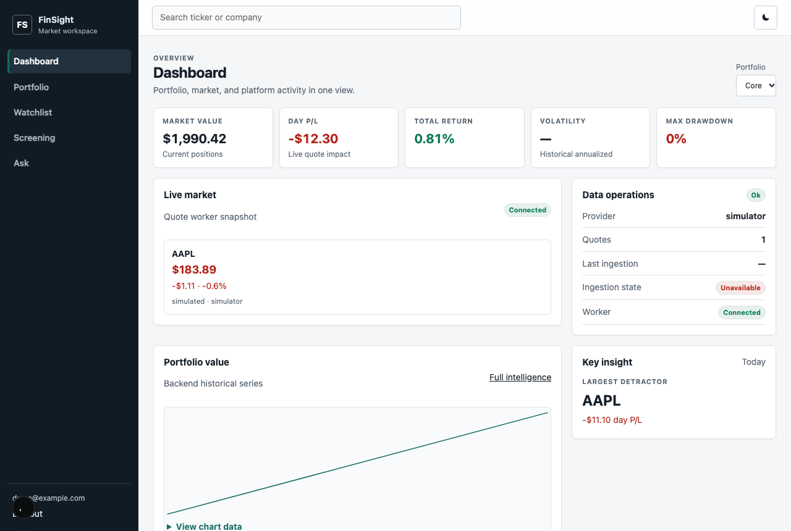

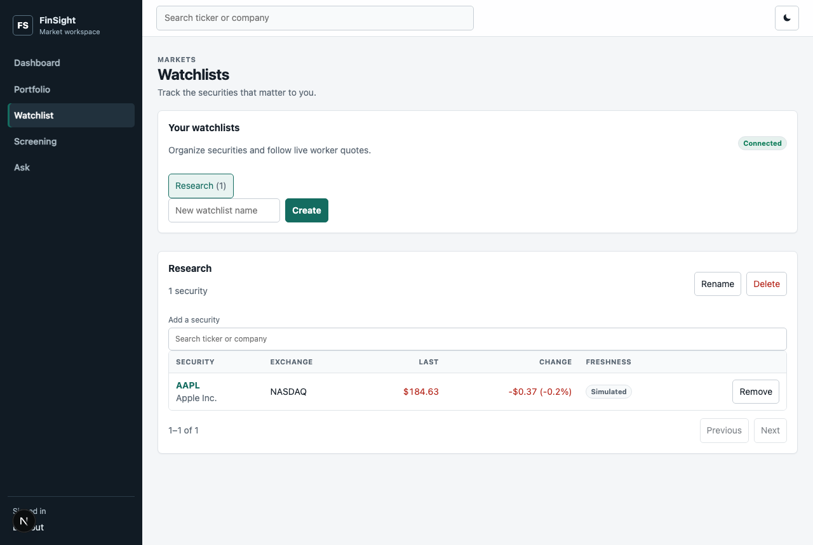

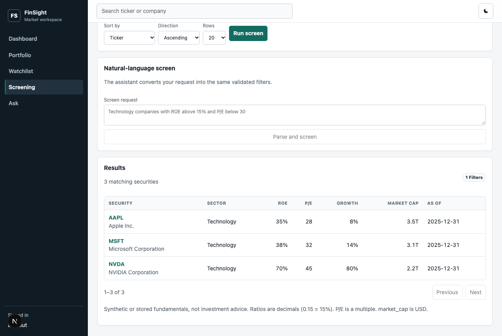

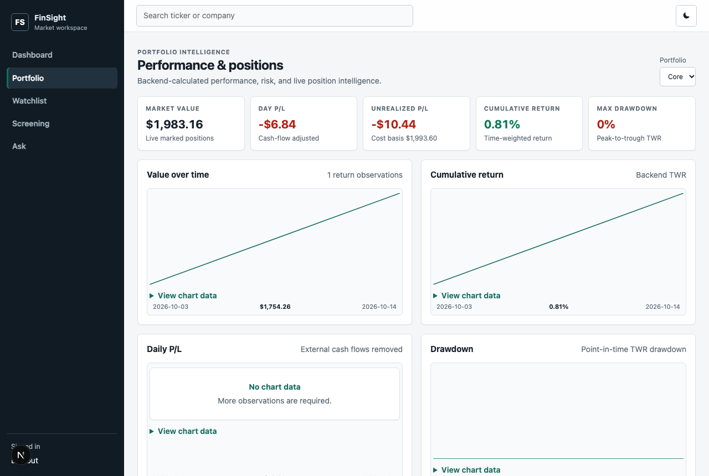

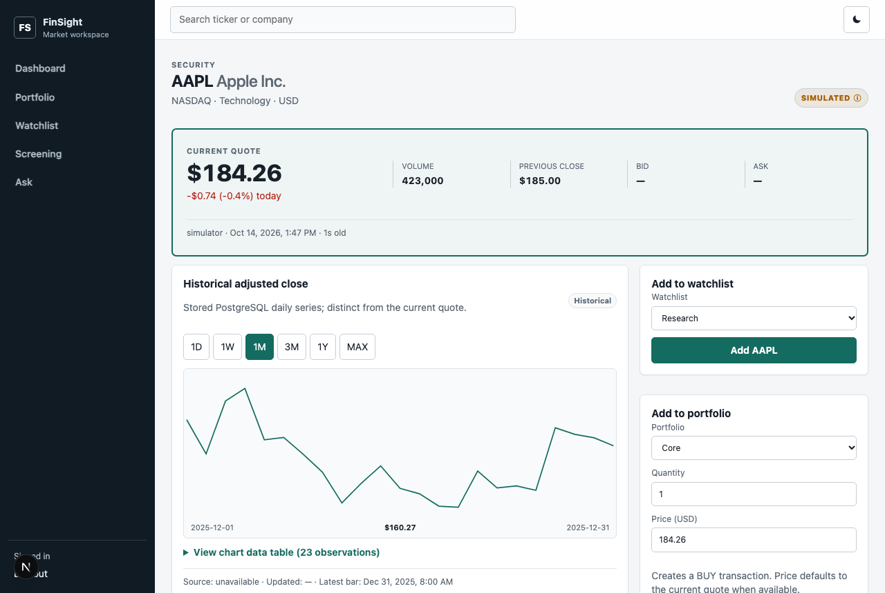

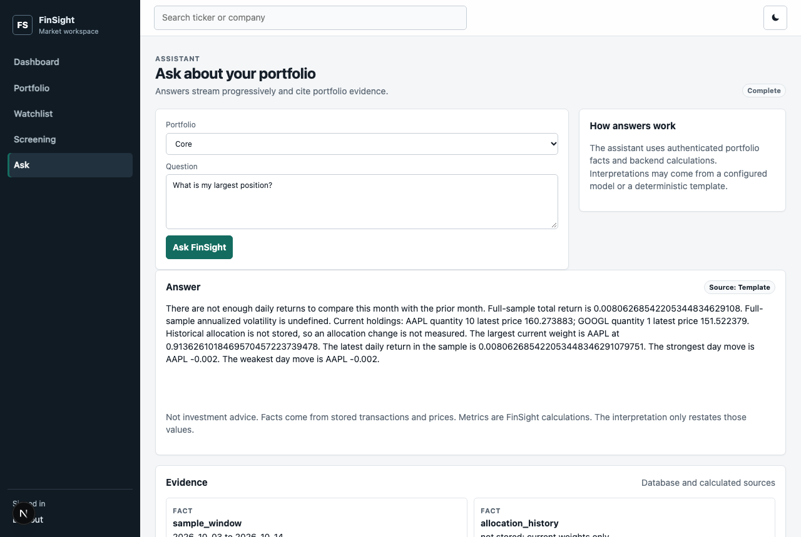

The earlier static `/ui` page, captured on 3 October 2026. Volatility is null because the portfolio had a single price day, so the assistant reports `insufficient_history` and does not claim volatility increased. Cache counters include the benchmark run plus those UI requests.

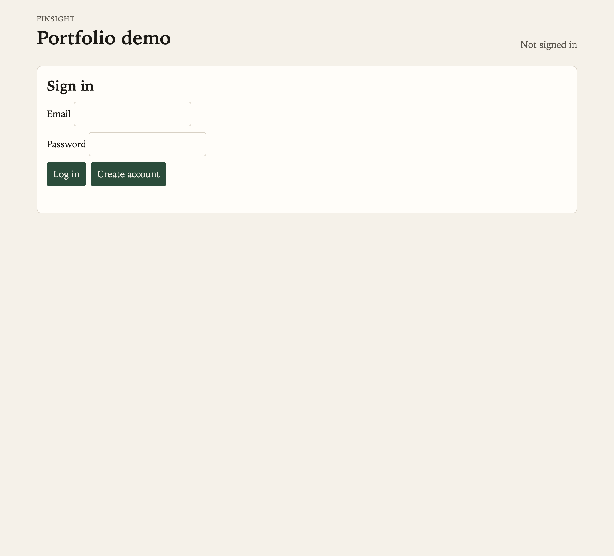

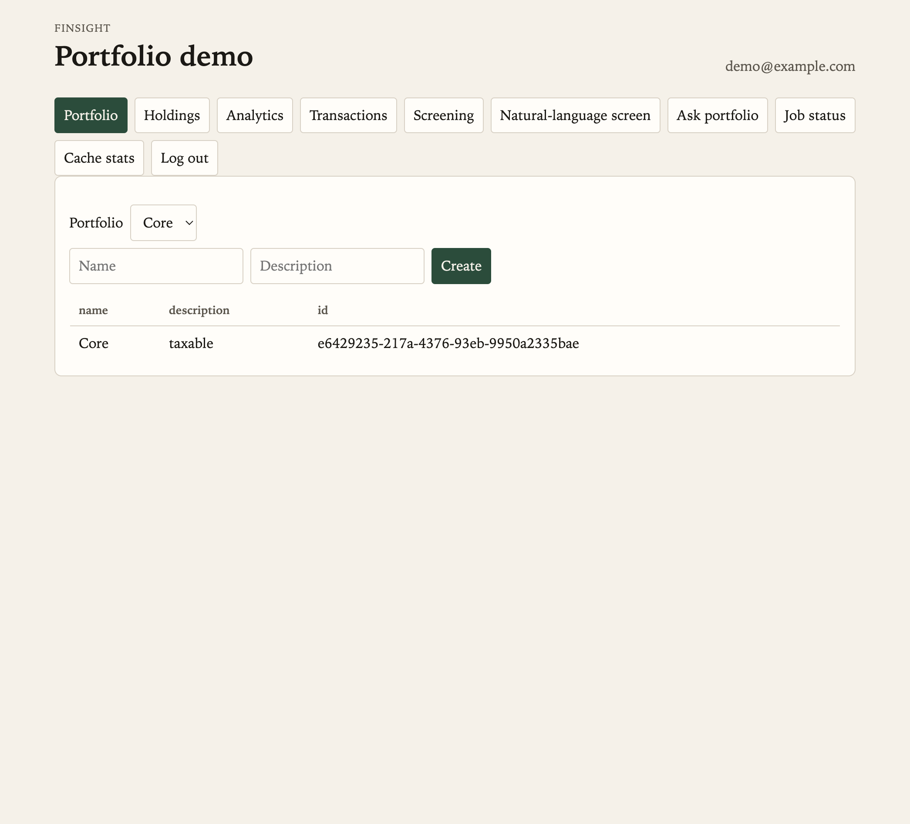

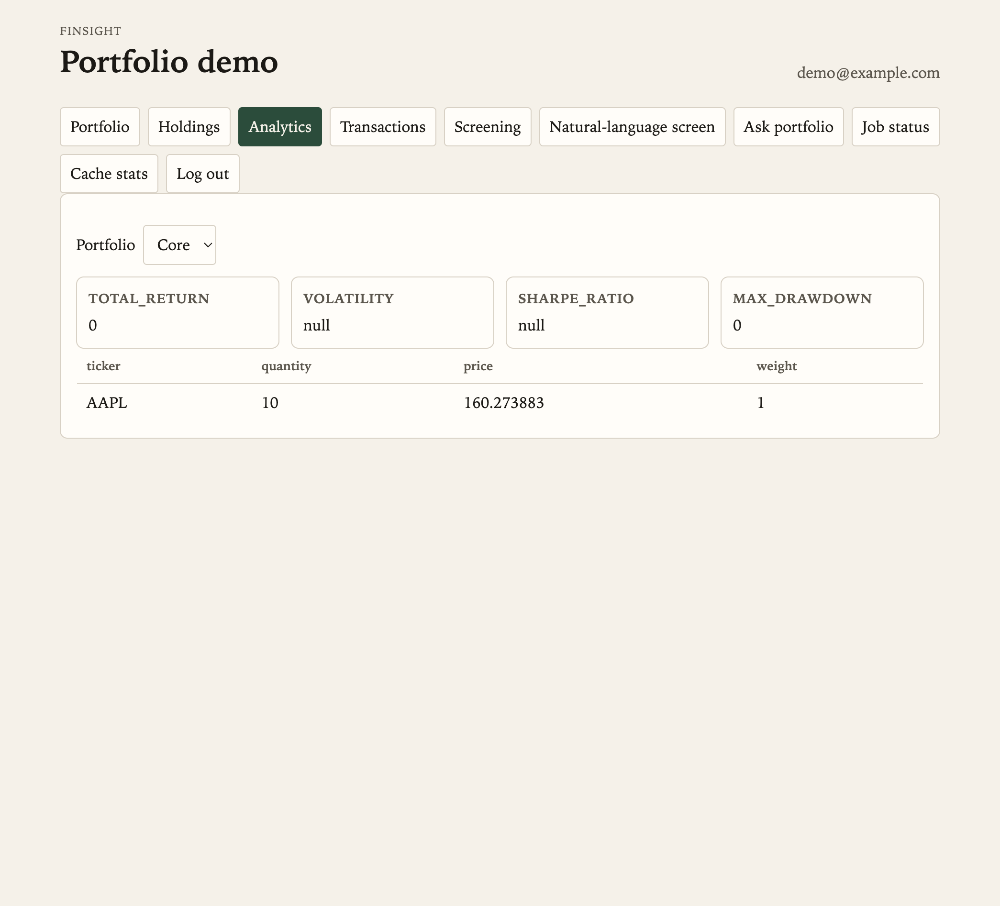

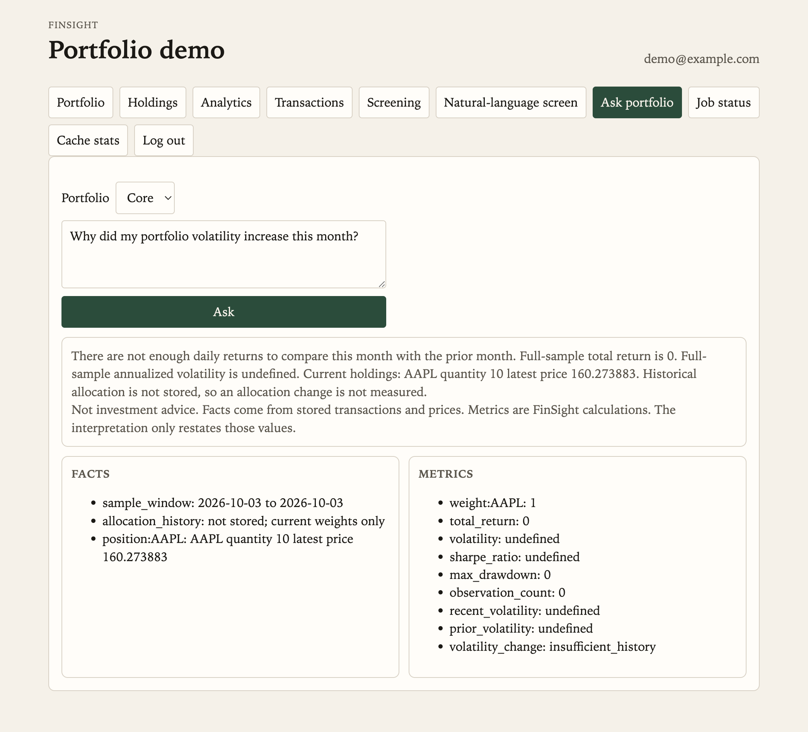

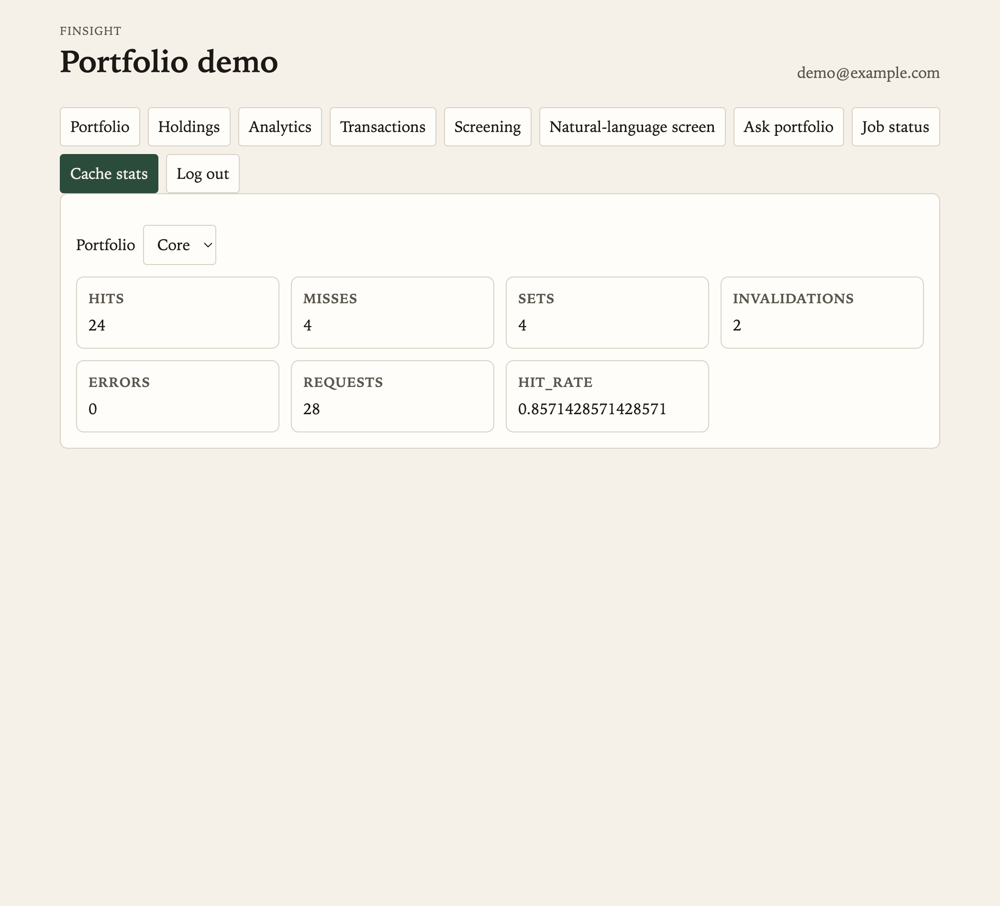

Host migrate/seed against the published port:

```bash
make migrate-host
make seed-host
```

### Environment variables

Copy `.env.example` to `.env` only if you run Uvicorn on the host against the published Postgres port. Compose injects `DATABASE_URL` for the `api` service and does not require a `.env` file. `.env` is gitignored.

| Variable | Purpose |
| --- | --- |
| `APP_NAME` | OpenAPI title |
| `ENVIRONMENT` | Logged on startup |
| `LOG_LEVEL` | Root log level |
| `DATABASE_URL` | SQLAlchemy / Alembic URL |
| `JWT_SECRET_KEY` | Secret used to sign access tokens; replace in production |
| `JWT_ALGORITHM` | Allowed JWT signing algorithm (default `HS256`) |
| `JWT_ISSUER` | Required token issuer (default `finsight`) |
| `JWT_ACCESS_TOKEN_MINUTES` | Access-token lifetime (default `30`) |
| `AI_PROVIDER` | `local` template/rules, or `openai` |
| `AI_OPENAI_API` | `responses` (default) or `chat` |
| `AI_API_KEY` | Chat API key. Empty for `local`. Never commit it |
| `AI_BASE_URL` | OpenAI-compatible base URL |
| `AI_MODEL` | Chat model name |
| `AI_TIMEOUT_SECONDS` | Chat request timeout (default `20`) |
| `QUOTE_PROVIDER` | `simulator`, `finnhub`, or `alpha_vantage` |
| `QUOTE_SYMBOLS` | Comma-separated tickers for the quote worker |
| `QUOTE_POLL_SECONDS` | Poll interval for simulator and Alpha Vantage |
| `QUOTE_TTL_SECONDS` | Redis lifetime of one live quote (default `30`) |
| `QUOTE_STALE_AFTER_SECONDS` | Age after which a quote is `stale` (default `15`) |
| `QUOTE_WORKER_HEARTBEAT_TTL_SECONDS` | Redis lifetime of the worker heartbeat (default `30`) |
| `AI_FALLBACK_TO_LOCAL` | Use the local evidence template if the remote model fails |
| `QUOTE_MAX_SYMBOLS` | Watchlist symbols followed by one worker (default `50`) |
| `QUOTE_RECONNECT_SECONDS` | First delay after a dropped Finnhub socket |
| `QUOTE_SYMBOL_REFRESH_SECONDS` | How often the stream reloads watchlist symbols |
| `ALPHA_VANTAGE_REALTIME` | Label `GLOBAL_QUOTE` realtime only with that entitlement |
| `NEWS_PROVIDER` | Empty inherits a news-capable quote provider; `none` stores no headlines |
| `MARKET_DATA_MAX_SECURITIES` | Symbols ingested in one run (default `25`) |
| `MARKET_DATA_MAX_WINDOW_DAYS` | Longest historical window (default `1825`) |
| `MARKET_DATA_ALLOW_FULL_HISTORY` | Allow Alpha Vantage `outputsize=full` |
| `FINNHUB_API_KEY` | Finnhub token. Empty for `simulator` |
| `NEWS_TTL_SECONDS` | Redis lifetime of cached headlines (default `900`) |
| `CORS_ORIGINS` | Browser origins allowed to call the API |
| `NEXT_PUBLIC_API_URL` | API base URL baked into the Next.js client |
| `RISK_FREE_RATE` | Annual decimal for Sharpe (default `0.05`) |
| `TRADING_DAYS_PER_YEAR` | Annualization factor (default `252`) |
| `MARKET_DATA_PROVIDER` | `stooq` or `alpha_vantage` |
| `MARKET_DATA_API_KEY` | Alpha Vantage key (empty for Stooq) |
| `SCHEDULER_ENABLED` | Start APScheduler on API boot (default `true`) |
| `MARKET_DATA_CRON` | 5-field cron in UTC (default `0 22 * * *`) |
| `MARKET_DATA_LOOKBACK_DAYS` | Inclusive window ending today (default `7`) |
| `JOB_STALE_AFTER_SECONDS` | Expire leftover `running` rows (default `3600`) |
| `CACHE_ENABLED` | Enable Redis read-through caching (default `true`) |
| `REDIS_URL` | Redis connection URL |
| `CACHE_KEY_PREFIX` | Namespace all FinSight keys (default `finsight`) |
| `ANALYTICS_CACHE_TTL_SECONDS` | Analytics TTL (default `300`) |
| `SCREENING_CACHE_TTL_SECONDS` | Screening TTL (default `300`) |
| `REDIS_SOCKET_TIMEOUT_SECONDS` | Fail-open timeout (default `0.2`) |

Local Compose credentials (`finsight` / `finsight`) are development defaults, not production secrets.

## Makefile

| Target | Action |
| --- | --- |
| `make up` | `docker compose up --build -d` |
| `make down` | `docker compose down` |
| `make logs` | Follow API logs |
| `make test` | pytest |
| `make lint` | Ruff |
| `make migrate` | `alembic upgrade head` inside the API container |
| `make seed` | Seed securities and prices inside the API container |
| `make migrate-host` | Alembic against `DATABASE_URL` on the host |
| `make seed-host` | Seed against `DATABASE_URL` on the host |
| `make ingest` | Vendor ingest inside the API container |
| `make ingest-host` | Vendor ingest on the host |
| `make benchmark-data` | Generate the default 10M-row PostgreSQL dataset |
| `make benchmark-baseline` | Downgrade to revision 0004 and record baseline plans |
| `make benchmark-optimized` | Upgrade to revision 0005 and record optimized plans |
| `make benchmark-compare` | Compare the two measured JSON reports |
| `make benchmark-cache` | Measure cold and repeated cached screen latency |
| `make quote-worker` | Publish live quotes to Redis |
| `make web` | Install and run the Next.js dashboard on port 3000 |
